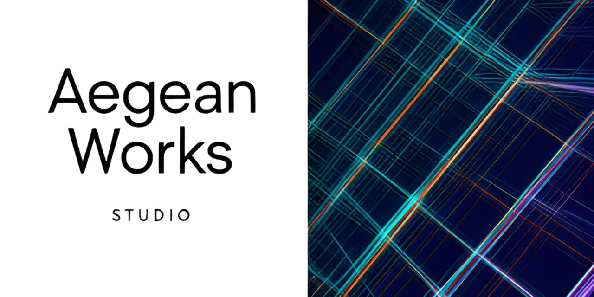
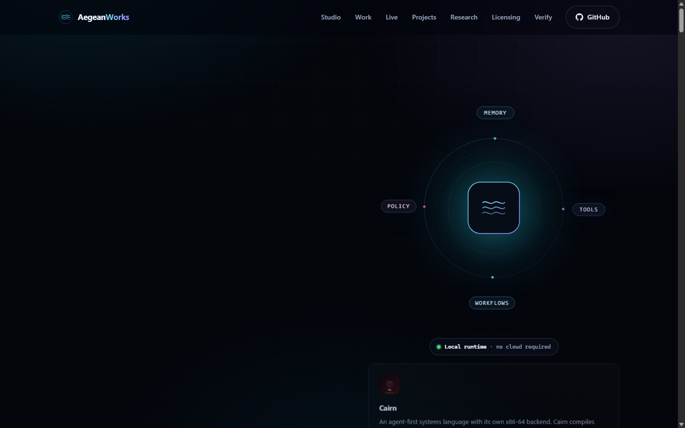
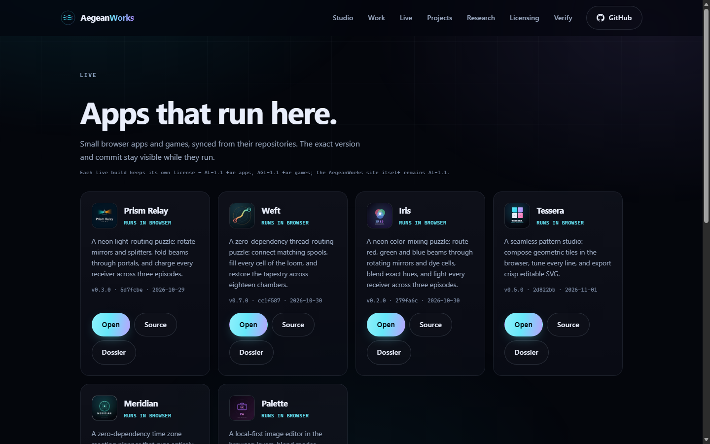

<!-- aegean:media:start -->
<p align="center"></p>
<!-- aegean:media:end -->
<p align="center">
</p>

<p align="center">
  <a href="https://aegeanworks.github.io/AegeanWorks/"></a>
  <a href="https://github.com/AegeanWorks/AIKit"></a>
  <a href="COMMERCIAL.md"></a>
  <a href="https://github.com/AegeanWorks?tab=repositories"></a>
</p>

<h3 align="center">We build software that thinks, remembers, and explains itself.</h3>

---

## What we build

AegeanWorks is an independent studio building **local-first AI systems**, **cognitive tooling**, and **computational research**. The work favors small composable parts, inspectable state, and software that still works when the network does not.

| Area | What it means in practice |
|---|---|
| **Cognitive systems** | Agent frameworks, tool routing, memory layers, and explicit belief control. |
| **Governed autonomy** | Delivery gates, audit trails, and disruption recovery for AI coding agents. |
| **Personal science** | N=1 experimentation, neuro-acoustics, and falsification-first research tooling. |
| **Playable systems** | Simulations, puzzles, and games built to make complex mechanics legible. |

---

## Featured systems

### [NeuroCore](https://github.com/AegeanWorks/NeuroCore)
A self-hosted, modular agent framework for persistent, tool-using autonomous systems. Workflows, long-term memory, RAG, and a plugin surface in one extensible runtime.

### [AIKit](https://github.com/AegeanWorks/AIKit)
Crash-resilient governance and delivery gates for AI coding agents: versioned task ledger, commit-level verification, secret scanning, and per-project gates.

### [N1-Engine](https://github.com/AegeanWorks/N1-Engine)
A local-first, privacy-focused platform for rigorous N-of-1 self-experimentation: apply scientific statistics to your own life data, on your own machine.

### [NeuralBeat](https://github.com/AegeanWorks/NeuralBeat)
A mathematically precise neuro-acoustic desktop app for binaural, monaural, and isochronic tones, with hardware-aware safety limits.

---

## Public project atlas

Every project repository below is public. Browse the full set on [GitHub](https://github.com/AegeanWorks?tab=repositories). The website's live atlas reads public repository titles, descriptions and topics from the GitHub API at page load; this snapshot remains the fallback for no-JavaScript readers and API failures. The portfolio toolbar filters by search, topic and archive status, keeps that view in the URL, and can reveal every topic in the catalogue from a bounded, scrollable topic shelf. Each portfolio card carries the repository's own logo, and opens a local dossier with its social preview, metadata, commit-stamped screenshots when media exists, and a README excerpt. Captures open in an in-page viewer with previous/next, captions and commit provenance, while the repository link remains one click away. Browser apps and games also appear on the [Live page](https://aegeanworks.github.io/AegeanWorks/play.html) with their version and commit; Prism-Relay, Weft, Iris, Tessera, Meridian, Palette and Orrery run in the page. Archiving a project keeps its last verified build in the Live catalog, marked as archived, so a retired repository stays playable instead of disappearing. Palette is the local-first image editor with layers, blend modes, clipping masks, layer transforms, gradients, selections, clipboard, layer-via-copy/cut, flatten, crop ratios, canvas size, histogram/auto levels, local autosave recovery, drawing tools, clone stamp, dodge/burn, adjustments, filters and scaled PNG/JPEG/WebP export; images never leave the browser. The [Editor page](https://aegeanworks.github.io/AegeanWorks/editor.html) still offers a full-window Palette session.

<details>
<summary><b>Cognitive AI &amp; Agent Infrastructure</b></summary>

| Project | Description |
|---|---|
| [Aegean-TGE](https://github.com/AegeanWorks/Aegean-TGE) | Native Windows hybrid CPU and GPU LLM inference engine in C++20 that treats system RAM and GPU VRAM as one coordinated memory tier. |
| [ModelDuck](https://github.com/AegeanWorks/ModelDuck) | A local GGUF model server and coding-model tuner: load a model, serve an OpenAI-compatible API, tune it for code. Runs on the CPU or a Vulkan GPU; no cloud account, no telemetry. |
| [Cairn](https://github.com/AegeanWorks/Cairn) | An agent-first systems language with its own x86-64 backend. Cairn compiles straight to a Windows PE executable: no C compiler, no assembler, no linker, no libc, no runtime library. |
| [NeuroCore](https://github.com/AegeanWorks/NeuroCore) | A complete, self-hosted AI agent framework. Visual flow editor · Persistent memory · RAG · Tools · Multi-platform messaging · Community marketplace. |
| [AIKit](https://github.com/AegeanWorks/AIKit) | Crash-resilient governance and delivery gates for AI coding agents: versioned task ledger, commit-level verification, secret scanning and per-project gates. Free for personal use under AL-1.1; commercial use under ACL-1.0. |
| [Lacon](https://github.com/AegeanWorks/Lacon) | An AI that thinks in as few letters as possible, recursively over a long context: its own alphabet, budget, thinker and recursive engine. No network, no API key, no model weights; the core is standard library only. Free personal use under AL-1.1; commercial use under ACL-1.0. |
| [Lattice](https://github.com/AegeanWorks/Lattice) | A provenance-first research knowledge graph for humans and AI agents. Local-first, SQLite-backed and standard library only. Free personal use under AL-1.1; commercial use under ACL-1.0. |
| [Assay](https://github.com/AegeanWorks/Assay) | Tamper-evident audit evidence for AI agents: a local-first hash-chained ledger, policy review, and offline-verifiable evidence packs. Free personal use under AL-1.1; commercial use under ACL-1.0. |
| [Aegean-Licensing](https://github.com/AegeanWorks/Aegean-Licensing) | The Aegean License family (AL, AGL and ASL 1.1) and the Aegean Commercial License: canonical texts, policies, commercial templates and certificate verification tooling for AegeanWorks projects. |
| [ChatDuck](https://github.com/AegeanWorks/ChatDuck) | A fast, local-first web chat UI for any OpenAI-compatible model server, including ModelDuck. It is one static page and a few modules: no build step, no framework, no backend, and no telemetry. |
| [AegeanWorks](https://github.com/AegeanWorks/AegeanWorks) | AegeanWorks is an independent studio building local-first AI systems, cognitive tooling, and computational research. The work favors small composable parts, inspectable state, and software that still works when the network does not. |

</details>

<details>
<summary><b>Research &amp; Simulation</b></summary>

| Project | Description |
|---|---|
| [N1-Engine](https://github.com/AegeanWorks/N1-Engine) | A local-first, privacy-focused platform for rigorous N-of-1 self-experimentation: apply scientific statistics to your own life data, on your own machine. Free personal use under AL-1.1; commercial use under ACL-1.0. |
| [Fluid-Universe](https://github.com/AegeanWorks/Fluid-Universe) | Falsification-first research codebase testing a Z3 circulant origin of the Koide lepton relation, with a separately labelled nematic-fluid UV speculation. Free non-commercial research under ASL-1.1; commercial use under ACL-1.0. |
| [PNN](https://github.com/AegeanWorks/PNN) | Oral, blood-brain barrier-penetrant agents that soften hypothalamic perineuronal nets to restore insulin signaling in obesity: research notes, data and computational analyses. Free non-commercial research under ASL-1.1; commercial use under ACL-1.0. |
| [Primordia](https://github.com/AegeanWorks/Primordia) | [ARCHIVED] Primordia is a zero-dependency evolution sandbox: seed a biosphere, run its clock, and watch genomes vary, compete and speciate. A run replays exactly from its seed, and a fossil record keeps the story of what happened. |
| [Orrery](https://github.com/AegeanWorks/Orrery) | An N-body gravitational sandbox that runs in your terminal or in your browser. Nine carefully chosen worlds, a symplectic integrator, optional relativity and collision physics, live energy diagnostics, orbit trails, CSV and JSON export, and no dependencies outside the Python standard library. |
| [Research-Engine](https://github.com/AegeanWorks/Research-Engine) | A falsification-first research engine that turns questions into provenance-backed claims, executable kill tests, and auditable verdicts. |
| [NeurologyClinicTemplates-TR](https://github.com/AegeanWorks/NeurologyClinicTemplates-TR) | Standardized Turkish anamnesis (patient history) templates for common neurology complaints, helping neurologists, residents and medical students document assessments completely and systematically. Free personal use under AL-1.1; commercial use under ACL-1.0. |
| [Atlas](https://github.com/AegeanWorks/Atlas) | An interactive visual knowledge platform for scientific figures. |

</details>

<details>
<summary><b>Health, Neuro &amp; Personal Tools</b></summary>

| Project | Description |
|---|---|
| [NeuralBeat](https://github.com/AegeanWorks/NeuralBeat) | A local-first neuro-acoustic desktop app that generates mathematically accurate binaural, monaural and isochronic tones for focus, meditation, relaxation and sleep. Free personal use under AL-1.1; commercial use under ACL-1.0. |
| [NeuroOptic](https://github.com/AegeanWorks/NeuroOptic) | A research-grade visual oscillator for brainwave entrainment: configurable 1-120 Hz frequencies, hardware-aware safety limits and drift-free phase accumulation. Free personal use under AL-1.1; commercial use under ACL-1.0. |
| [NeuralDeck](https://github.com/AegeanWorks/NeuralDeck) | An offline desktop app that turns PDFs, Word files and other documents into high-quality Anki flashcards with a local LLM, with smart deck matching, AI editing and direct Anki sync. Free personal use under AL-1.1; commercial use under ACL-1.0. |
| [NobetWizard](https://github.com/AegeanWorks/NobetWizard) | An automated duty roster generator built with Streamlit: fair monthly schedules under constraints such as gender, rest days and availability, with Excel and PDF export, in English and Turkish. Free personal use under AL-1.1; commercial use under ACL-1.0. |
| [Mnemo](https://github.com/AegeanWorks/Mnemo) | A dependency-free, local-first spaced-repetition flashcard CLI: study each card on the day the SM-2 algorithm says it is due, and keep everything in one readable JSON file on your machine. Free personal use under AL-1.1; commercial use under ACL-1.0. |
| [Meridian](https://github.com/AegeanWorks/Meridian) | [ARCHIVED] A zero-dependency time zone meeting planner that runs entirely in the browser: add people and cities, compare every local hour side by side, find the overlap that works for everyone, then share it as a link or a calendar file. |
| [Palette](https://github.com/AegeanWorks/Palette) | A local-first, zero-dependency image editor for the browser: layers, blend modes, selections, gradients, filters, autosave recovery and PNG/JPEG/WebP export. |
| [Afterimage](https://github.com/AegeanWorks/Afterimage) | [ARCHIVED] A visual perception gauntlet with a daily challenge: one tile in every grid is a shade, a size, or an angle off. Installable, offline-capable PWA. |
| [NoMoreClutter](https://github.com/AegeanWorks/NoMoreClutter) | An AI desktop app that organizes your files with large language models: it analyzes, categorizes and renames them with descriptive names, and works with local LLMs. Free personal use under AL-1.1; commercial use under ACL-1.0. |

</details>

<details>
<summary><b>Developer Tools &amp; Utilities</b></summary>

| Project | Description |
|---|---|
| [Tessera](https://github.com/AegeanWorks/Tessera) | A seamless pattern studio: compose geometric tiles in the browser and export crisp SVG. |
| [Pocket-Planner](https://github.com/AegeanWorks/Pocket-Planner) | A local-first task manager for capturing, prioritizing, and completing work from a fast terminal workflow. |
| [Dupefinder](https://github.com/AegeanWorks/Dupefinder) | Read-only duplicate file finder that groups byte-identical files by size and SHA-256 and reports reclaimable space. |
| [Driftwood](https://github.com/AegeanWorks/Driftwood) | Offline CLI that ranks code hotspots by combining git churn history with file complexity, so maintainers know where refactoring pays off. |
| [Chronos](https://github.com/AegeanWorks/Chronos) | A lightweight, local-first focus and session orchestrator for developers: track deep-work sessions, micro-milestones and interruptions, and get productivity insights. Python standard library only. Free personal use under AL-1.1; commercial use under ACL-1.0. |
| [Gauge](https://github.com/AegeanWorks/Gauge) | [ARCHIVED] A zero-dependency terminal ruler for numeric series. gauge reads numbers from arguments, a file or a pipe and draws a sparkline, signed bars, a histogram, a box plot or a compact statistics block. stats --json is the machine surface for another tool. |
| [Tally](https://github.com/AegeanWorks/Tally) | A dependency-free, local-first expense ledger for the terminal: record what you spend, list it and see where the money went, all in one readable JSON file on your machine. Free personal use under AL-1.1; commercial use under ACL-1.0. |
| [Tempo](https://github.com/AegeanWorks/Tempo) | A focus timer you run on your own machine: one Python process, a browser page, no dependencies, no account and no network calls. Focus and break phases alternate, and every fourth break is a long one. Free personal use under AL-1.1; commercial use under ACL-1.0. |
| [Pebble](https://github.com/AegeanWorks/Pebble) | A tiny, dependency-free scripting language: lexer, parser, tree-walking evaluator and REPL. Built as an AIKit evaluation project, where the process is under test as much as the code. Free personal use under AL-1.1; commercial use under ACL-1.0. |
| [Photo-Harbor](https://github.com/AegeanWorks/Photo-Harbor) | Self-hosted photo server for Windows: an iPhone sends new photos over home Wi-Fi through Apple Shortcuts, no app needed, and an optional native Android app does the same, with a verified-hash cleanup and a gallery. |
| [Muse](https://github.com/AegeanWorks/Muse) | Prompt-driven AI music creation with an automated listener that scores how well each track fits its theme, available as a CLI and a Python library. Free personal use under AL-1.1; commercial use under ACL-1.0. |
| [UI-Sandbox](https://github.com/AegeanWorks/UI-Sandbox) | A small React + Vite surface for exercising AIKit's bounded UI guard: one screen, token-driven theming, and a labelled control for every interaction. Free personal use under AL-1.1; commercial use under ACL-1.0. |
| [Aegean-Reforge](https://github.com/AegeanWorks/Aegean-Reforge) | Archived: Aegean Reforge is integrated into AegeanWorks/AIKit. Progressive, evidence-backed Git history auditing and safe repair now ships as reforge/ plus reforge.py. |

</details>

<details>
<summary><b>Games &amp; Playable Experiments</b></summary>

| Project | Description |
|---|---|
| [Weft](https://github.com/AegeanWorks/Weft) | A zero-dependency thread-routing puzzle: draw glowing threads between matching spools, fill every cell of the loom, and restore the tapestry across twenty-four chambers, with a fresh 7x7 daily weave. Static HTML/CSS/ES modules for any static host. |
| [Iris](https://github.com/AegeanWorks/Iris) | A neon color-mixing puzzle: route red, green and blue beams through rotating mirrors and dye cells, blend exact hues, and light every receiver across three episodes. |
| [Dustline](https://github.com/AegeanWorks/Dustline) | Dustline: Survivors is a top-down horde-survival shooter with endless procedural arenas, auto-firing weapons, 7 maps, 18 mob types, rotating bosses plus megas, Boss Rush mode and extraction banking. |
| [Aldervale](https://github.com/AegeanWorks/Aldervale) | A 2.5D medieval RPG drawn in tiny ASCII cells: low-poly 3D models baked into shaded sprites, voxel terrain, fog, day and night, water, quests, combat, loot, shops and saves. Python standard library only: no dependencies, no assets, no build step. Free personal play under AGL-1.1; commercial use under ACL-1.0. |
| [MemoryReconstruction](https://github.com/AegeanWorks/MemoryReconstruction) | A top-down action roguelike about rebuilding a shattered world from lost memories. |
| [Crypt-Crawler](https://github.com/AegeanWorks/Crypt-Crawler) | Tactical turn-based web dungeon crawler with procedural levels, Normal/Hard difficulty, class passives, status combos, per-floor omens, a turn-cost trap search and disarm, mimic chests, a two-way merchant, seed replay, five-slot equipment, side-by-side loot comparison, filterable inventory, a persistent lore codex, branching soul encounters... |
| [Cyberpulse](https://github.com/AegeanWorks/Cyberpulse) | A retro-cyberpunk terminal hacking game built on behavioral psychology: procedural puzzle nodes, ICE defenses, push-your-luck extraction, persistent progression and a five-act campaign. Python standard library only. Free personal play under AGL-1.1; commercial use under ACL-1.0. |
| [Fold](https://github.com/AegeanWorks/Fold) | A 4x4 tile-merge puzzle you run on your own machine: one Python process, a browser page, no dependencies, no account and no network calls. Slide, merge and chase 2048; the server owns the rules and the browser only renders. Free personal play under AGL-1.1; commercial use under ACL-1.0. |
| [Prism-Relay](https://github.com/AegeanWorks/Prism-Relay) | A neon light-routing puzzle game: rotate mirrors and splitters, fold beams through portals, and charge every receiver across three episodes. Free personal play under AGL-1.1; commercial use under ACL-1.0. |
| [Voidfarer](https://github.com/AegeanWorks/Voidfarer) | A zero-dependency space flight and exploration simulator with an autonomous deep-space fleet, a procedural galaxy and a Windows cockpit: route reactor power, board derelicts, scoop fuel, command drones, fight and trade. Free personal play under AGL-1.1; commercial use under ACL-1.0. |
| [Keystone](https://github.com/AegeanWorks/Keystone) | A small, game-agnostic 3D engine core in Python: OpenGL 3.3 PBR rendering, scene graph, meshes/OBJ, fixed-step loop, rebindable input, animation, particles, audio, collision, replay, atomic saves, batch planning/merging, and a HUD/profiler overlay with an embedded bitmap font. |

</details>

---

## Research threads

- **Obesity and incretin regulation** — GLP-1 signaling, hypothalamic circuitry, and falsifiable mechanistic models.
- **Memory integrity** — how agents store, revise, and falsify beliefs without drifting.
- **Neuro-acoustics** — precise entrainment, perceptual safety, and measurable outcomes.
- **Computational cosmology** — lepton mass relations and fluid analogies, kept clearly separated from speculation.
- **Consciousness engineering** — architecture questions treated as engineering constraints, not decoration.

---

## Philosophy

> **Local-first over API dependency.**  
> **Modular over monolithic.**  
> **Structured cognition over prompt chaos.**  
> **Falsification over confident prose.**

---

## Toolbox

<p>
  
  
  
  
  
  
</p>

---

<!-- aegean:brand-assets:start -->
## 🎨 Brand Assets

> **AI-Generated Brand Artwork.** The banner and logo are **AI-generated brand assets**. They are illustrative and may not literally depict every feature or the full project scope.
<!-- aegean:brand-assets:end -->

## License

AegeanWorks publishes source-available and open-source projects. AL-1.1 for software, AGL-1.1 for games, ASL-1.1 for research, and the Aegean Commercial License 1.0 (ACL-1.0) for commercial use; see [COMMERCIAL.md](COMMERCIAL.md). The browser app builds under `docs/live/` keep their own license: AL-1.1 for apps and AGL-1.1 for games. The vendored Palette build under `docs/editor/` is AL-1.1 for personal use and ACL-1.0 for commercial use. Some repositories keep GNU AGPL-3.0, Apache-2.0 or MIT, and each repository's LICENSE governs. Versions published under GNU AGPL-3.0 keep that grant, including its commercial permissions. The canonical texts and tier table live in the [license catalog](https://github.com/AegeanWorks/Aegean-Licensing/blob/master/licenses/CATALOG.md). A commercial certificate can be checked against the public register at [aegeanworks.github.io/AegeanWorks/verify.html](https://aegeanworks.github.io/AegeanWorks/verify.html).

---

## Connect

- **Website** — [aegeanworks.github.io/AegeanWorks](https://aegeanworks.github.io/AegeanWorks/)
- **Install and offline** — the site is installable and caches its shell, project snapshot and trust pages for offline reading.
- **Security** — [security.html](https://aegeanworks.github.io/AegeanWorks/security.html)
- **Privacy** — [privacy.html](https://aegeanworks.github.io/AegeanWorks/privacy.html)
- **Accessibility** — [accessibility.html](https://aegeanworks.github.io/AegeanWorks/accessibility.html)
- **GitHub** — [@AegeanWorks](https://github.com/AegeanWorks)
- **X** — [@AegeanWorks](https://x.com/AegeanWorks)
- **Commercial licensing** — [aegean-licensing@proton.me](mailto:aegean-licensing@proton.me)

<p align="center"><sub>Built in public, one inspectable system at a time.</sub></p>

---

## Cold-Start Quick Reference

- **Runtime Prerequisites**: Git 2.30+, Python 3.10+ (standard library only), and Node 20+ for the browser-verifier and live-atlas parity gates.

**Canonical Regression Shield Gate**:
```bash
python -m unittest discover -s tests
```

**Browser-Verifier Parity Gate**:
```bash
node tests/verify/run-tests.mjs
```

**Live-Atlas Parity Gate**:
```bash
node tests/atlas/run-tests.mjs
```

**Project-Page Parity Gate**:
```bash
node tests/project/run-tests.mjs
```

All five suites run in GitHub Actions on every push and pull request (`.github/workflows/tests.yml`). The Node suites pin the browser verifier, the live GitHub atlas, the README renderer and the live catalog to the same rules as the Python code. A scheduled `media.yml` run pulls logos, social previews and repository captures, regenerates the manifests and commits them when a repository changed. A scheduled `live.yml` run copies the browser app builds, enforces their static contract, and records their versions and commits.

### What's Inside

```text
AegeanWorks/
├── README.md                <- Profile and public project atlas
├── LICENSE                  <- Aegean License 1.1 (AL-1.1): free personal use
├── COMMERCIAL.md            <- Licensing tiers and ACL-1.0 commercial terms
├── LICENSES/                <- Pinned license text for REUSE metadata
│   ├── LicenseRef-AL-1.1.txt
│   ├── LicenseRef-AGL-1.1.txt <- Live app and game builds
│   └── LicenseRef-ASL-1.1.txt <- Live research tool builds
├── REUSE.toml               <- REUSE aggregate license annotations
├── .gitignore               <- Git and AIKit transient-state exclusions
├── .gitattributes           <- Byte-stable checkouts for hashed browser builds
├── package.json             <- Node module marker for the browser-core parity suites
├── assets/
├── docs/                    <- Static GitHub Pages site and its assets
│   ├── .nojekyll            <- Serve files exactly as committed
│   ├── CNAME                <- The custom domain the Pages site serves on
│   ├── 404.html             <- Branded not-found page
│   ├── index.html           <- Studio profile and public project atlas
│   ├── project.html         <- Local project dossier (metadata and README excerpt)
│   ├── project-core.js      <- Pure README block and repository lookup rules
│   ├── project.js           <- Dossier fetch and safe text rendering
│   ├── lightbox-core.js     <- Pure viewer index and counter rules
│   ├── lightbox.js          <- Dialog viewer: navigation, focus and metadata
│   ├── live.html            <- Redirect to the play.html address
│   ├── live-core.js         <- Pure manifest, lookup and version-label rules
│   ├── live.js              <- Catalog rendering, player and URL state
│   ├── live-home.js         <- Homepage live app cards
│   ├── live.json            <- Synced app versions, commits and digests
│   ├── play.html            <- Live app catalog and fullscreen player
│   ├── live/                <- Versioned builds, screenshots and slider data
│   ├── editor.html          <- Palette image editor workbench
│   ├── editor/              <- Vendored Palette build and content-hash manifest
│   ├── media/               <- Dossier logos, social previews and screenshots
│   ├── atlas-snapshot.json  <- Static fallback for the atlas and dossiers
│   ├── verify.html          <- Public certificate verifier (certificate stays local)
│   ├── verify-core.js       <- Shared format-2 canonicalization and checks
│   ├── verify.js            <- Browser UI and canonical register fetch
│   ├── atlas-core.js        <- Pure live-atlas validation, inference and sync planning
│   ├── atlas.js             <- GitHub API fetch, cache and DOM reconciliation
│   ├── app.js               <- Navigation, filtering, reveal and service-worker registration
│   ├── sw-client.js         <- Shell update check, reload and stale-cache recovery
│   ├── sw.js                <- Cached shell, offline fallback and API cache
│   ├── offline.html         <- Branded offline page
│   ├── styles.css           <- Zero-dependency design system
│   ├── favicon.svg          <- Site mark
│   ├── icon-192.png         <- Install icon
│   ├── icon-512.png         <- Install icon
│   ├── apple-touch-icon.png <- iOS home-screen icon
│   ├── og.png               <- Social card
│   ├── robots.txt           <- Crawler rules
│   ├── sitemap.xml          <- Indexed pages
│   ├── security.html        <- Security model and disclosure
│   ├── privacy.html         <- Data handling and third-party requests
│   ├── accessibility.html   <- WCAG commitment, limits and feedback
│   ├── .well-known/
│   │   └── security.txt     <- RFC 9116 disclosure metadata
│   └── site.webmanifest     <- Web app manifest
├── .github/
│   ├── FUNDING.yml          <- Sponsorship configuration
│   └── workflows/
│       ├── tests.yml        <- CI regression gate on every push
│       ├── media.yml        <- Weekly refresh of logos, previews and captures
│       └── live.yml    <- Weekly refresh of the browser app builds
├── .aikit/
│   ├── project.json         <- Project identity and test command
│   ├── media.json           <- Reviewed brand media state and approvals
│   ├── guidelines.md        <- Project-only rules
│   ├── decisions.md         <- ADR register
│   ├── codebase_map.md      <- Generated AST symbol catalog
│   ├── task_ledger.json     <- Delivery ledger
│   ├── task_ledger_archive.jsonl <- Archived delivery checkpoints
│   ├── ui.json              <- Bounded UI surfaces and their evidence digests
│   ├── ui_history.json      <- Reviewed UI task history
│   └── reforge.json         <- Progressive audit run state and applied findings
├── tools/
│   ├── build_dossier_media.py  <- Fetches, optimizes and verifies dossier media
│   ├── sync_editor.py     <- Copies and verifies the Palette editor build
│   ├── sync_live_apps.py  <- Copies and verifies the browser app builds
│   └── social/            <- Studio X manager: gates, media pipeline, browser publish
└── tests/
    ├── test_profile.py      <- Content, metadata and link integrity tests
    ├── test_social_manager.py <- Social gates: topic, evidence, media, spam, approval
    ├── test_social_browser.py <- Browser publish: package, compose-only, armed click
    ├── test_social_review.py <- Aesthetic review: distortion, size, sharpness blocks
    ├── test_sync_live_digest.py <- Live build digest and retention tests
    ├── test_sync_editor_digest.py <- Editor line-ending and binary digest tests
    ├── live/
    │   └── run-tests.mjs     <- Live catalog and version-label parity
    ├── metadata/
    │   └── repositories.json <- GitHub title, topic and description snapshot
    ├── vectors/
    │   └── verification-vector.json <- Known-answer certificate fixture
    ├── verify/
    │   └── run-tests.mjs    <- Browser-verifier parity suite
    ├── atlas/
    │   └── run-tests.mjs    <- Live GitHub atlas parity suite
    └── project/
        └── run-tests.mjs    <- README-rendering parity suite
```

<!-- aegean:screenshots:start -->
## Screenshots

<a href="https://github.com/AegeanWorks/AegeanWorks/commit/ea26791"></a>

<a href="https://github.com/AegeanWorks/AegeanWorks/commit/ea26791"></a>

*commit `ea26791` · 2026-11-03 · viewport 1440x900 · home plus live catalog*
<!-- aegean:screenshots:end -->
